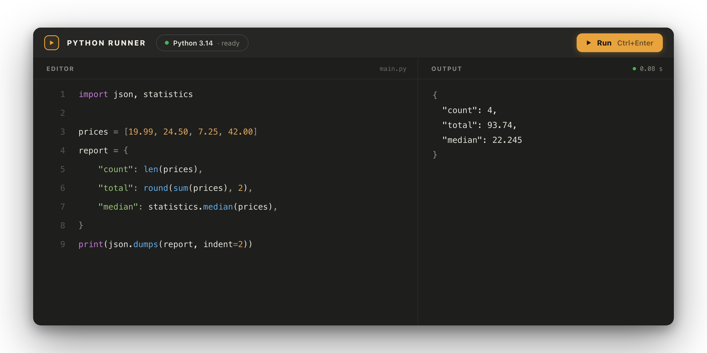
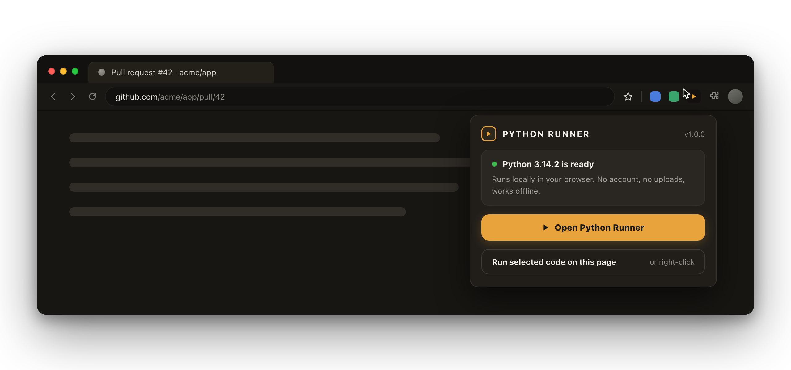

# Python Runner — free Chrome extension

*Python code in front of you, and the machine has no interpreter? Run it right now — in a browser tab, without installing anything.*

Python Runner is a local code runner for Chrome: paste a snippet or drop a `.py` file, press Run, read the output. The interpreter lives inside the extension, so your script never leaves your computer — no server, no account, no internet needed.

  

## What it does

Once installed, Python Runner opens in its own tab: editor on the left, output on the right. Paste a snippet, drop a file, or open one — and the script runs top to bottom, exactly as written:

- **Syntax highlighting, line numbers, auto-indent** — pasted code is readable the moment it lands.
- **Run with one button or Ctrl+Enter** — and **Stop** halts even an infinite loop, so you don't have to open a task manager.
- **Output streams live** — and errors show a real CPython traceback with matching line numbers, the same thing a terminal would print.
- **Stdin field for `input()`** — interactive scripts ask questions and pick up where they paused, the same rhythm you'd get in a terminal.
- **Snippets saved on the device** — reopen yesterday's script in one click.

There is no server on the other end of this. The interpreter lives inside the extension itself, so your script never leaves the computer and everything keeps working with the network gone: on a plane, behind a corporate firewall, on a locked-down work laptop — same as at home.

## Who it's for

Anyone who needs to run Python **right now** on a machine where installing Python is not an option: school computers, work laptops, someone else's desk. Five lines from a tutorial, a fix copied out of a GitHub issue, a whole `.py` file from a colleague — paste it, drop it, or open it, and it runs.

If you're going to keep writing code, you'll eventually want a full Python install with packages and virtual environments — and this extension is not that. It is the shortest path between "I have Python code" and "it ran", for machines where the classic setup is refused.

## Quick Start

Two steps, about fifteen seconds:

1. **[Install from Chrome Web Store](https://chromewebstore.google.com/detail/%D0%B7%D0%B0%D0%BF%D1%83%D1%81%D1%82%D0%B8%D1%82%D1%8C-python-%D0%BE%D0%BD%D0%BB%D0%B0%D0%B9%D0%BD-p/lioibcedpohmlcepmignijeddplkejpo)** — free, one click, no account.

2. **Open the runner** — pin the extension, click the icon, paste your code, press Run.

  

There is no first-run wizard, no fields to fill in, nothing to sign up for, and both steps happen once. If you keep the tab pinned, the runner becomes part of the page, like the input box. And if it ever shows stale values, reload the tab once and the real numbers take their place.

## Privacy

Nothing leaves your browser. No account. No tracking.

Python Runner has no backend, no analytics and no sign-in. The scripts you run are computed locally from the session you are already using — there is no server to send them to and no database for them to sit in. Uninstall the extension and every trace of it goes with it, settings included, because there are no settings.

That is not a policy ambition; it is an architecture fact. With nothing to send and nowhere to send it, privacy stops being a promise and becomes arithmetic. The people who wrote this extension use it themselves, on their own machines, and would notice anything that talked to the network.

The full privacy policy says the same thing in more words, for anyone who wants the details in writing.

## Links

- **Install** — [Chrome Web Store](https://chromewebstore.google.com/detail/%D0%B7%D0%B0%D0%BF%D1%83%D1%81%D1%82%D0%B8%D1%82%D1%8C-python-%D0%BE%D0%BD%D0%BB%D0%B0%D0%B9%D0%BD-p/lioibcedpohmlcepmignijeddplkejpo): free, one click, no account.
- **Privacy** — [what is and is not collected](https://pinwisp.com/python-runner/privacy/)
- **More free tools** — [pinwisp.com](https://pinwisp.com), other small and honest utilities from the same bench.

If Python Runner has saved you a setup headache on a locked-down machine, a short review on the store page helps the next subscriber find it faster than any store search does.
